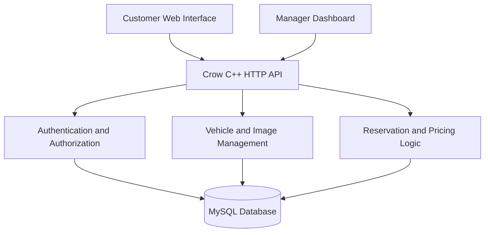

# Vehicle-Rental-System

# QuickRoute Rentals

### Design and Implementation of a Modular Vehicle Rental System

**QuickRoute Rentals** is a full-stack vehicle rental management application developed as a Computer Science senior project at the **University of Houston–Downtown**. It brings customer-facing vehicle browsing and reservations together with a separate management dashboard for maintaining rental inventory, photographs, and bookings.

The project uses **C++** and the **Crow HTTP framework** for its backend, **MySQL** for persistent data storage, and **HTML, CSS, and JavaScript** for the web interfaces. Instead of relying on a hardcoded vehicle catalog, the website retrieves real vehicle records through its C++ HTTP API.

> **Project scope:** This is a locally run academic application. It is not configured or audited for public production deployment, and it does **not** charge payment cards online.

## Table of Contents

- [Project Objectives](#project-objectives)
- [Technology Stack](#technology-stack)
- [Main Features](#main-features)
- [System Architecture](#system-architecture)
- [Database Overview](#database-overview)
- [Project Files](#project-files)
- [Getting Started](#getting-started)
- [Application Pages](#application-pages)
- [API Overview](#api-overview)
- [Example Workflows](#example-workflows)
- [Testing Checklist](#testing-checklist)
- [Limitations and Security](#limitations-and-security)
- [Possible Future Improvements](#possible-future-improvements)
- [Author](#author)

## Project Objectives

Small and medium-sized rental businesses may struggle with manually maintained vehicle inventory, inconsistent pricing information, and reservation conflicts. QuickRoute Rentals was designed to demonstrate how a modular web-based solution can organize those processes in a single system.

The main objectives are to:

1. Display rental vehicle inventory stored in MySQL.
2. Allow customers to search, filter, and inspect available vehicles.
3. Support customer accounts and rental reservations.
4. Check requested rental dates and calculate estimated rental costs.
5. Give authorized managers tools to maintain vehicle details and photographs.
6. Support reservation oversight and payment-at-pickup recordkeeping.
7. Apply modular software design through separate entity, control, and interface responsibilities.

## Technology Stack

| Component | Technology | Role |
| --- | --- | --- |
| Backend | C++ | Server-side logic and database operations |
| HTTP framework | Crow | Routes, requests, and JSON responses |
| Database | MySQL | Persistent vehicles, accounts, images, and reservations |
| Database integration | MySQL Connector/C++ | Communication between C++ and MySQL |
| Frontend | HTML5, CSS3, JavaScript | Customer pages and manager dashboard |
| Development environment | Microsoft Visual Studio 2022 | C++ development and debugging |
| Dependency management | vcpkg | Crow and related C++ dependencies in the existing setup |
| Database administration | MySQL Workbench | Database inspection and administration |
| Version control | Git and GitHub | Source management and project documentation |
| Design documentation | UML / diagrams | Use cases, classes, and data relationships |

## Main Features

### Customer Features

- Browse vehicles loaded dynamically from the MySQL database.
- Search by terms such as vehicle make, model, category, year, or vehicle ID.
- Filter inventory by make, category, status, year, and price range.
- Sort results by price, year, or make.
- View vehicle details and a photo gallery.
- Register, log in, and manage an authenticated session.
- Select pickup and return dates, check availability, and view a rental quote.
- Create reservations and review personal booking records.
- Cancel eligible unpaid reservations.
- Choose **card at pickup** or **cash at pickup** as a payment preference; neither option processes an online charge.

### Manager Features

- Sign in to an authorized manager account.
- View the inventory dashboard and refresh the vehicle list.
- Search and filter vehicles within the management interface.
- Create new vehicles and upload their photographs in the same workflow.
- Edit vehicle information, including make, model, year, category, daily rate, and status.
- View, upload, and manage vehicle photographs, including the primary image.
- Access the **Archive / Delete Vehicles** management page.
- Review customer reservations and manage cancellations.
- Record bookings as **paid** after payment has actually been received at pickup.

> Exact availability of individual features depends on which project updates have been integrated and tested in the checked-in source.

## System Architecture

The project is organized around three logical layers:

1. **Interface Layer:** Customer website and manager pages implemented with HTML, CSS, and JavaScript.
2. **Control Layer:** Crow HTTP routes, input validation, authentication/authorization, reservation logic, and database operations in C++.
3. **Entity Layer:** Domain concepts such as `Vehicle`, `Customer`, and `Reservation`, backed by records stored in MySQL.



This separation helps keep the user interface independent from the database queries and backend business rules.

## Database Overview

The backend currently targets the local database configuration:

| Setting | Development value |
| --- | --- |
| MySQL host | `127.0.0.1` |
| MySQL port | `3306` |
| Schema | `vehicle_rental_db` |
| Database account | `vehicle_app` |
| Application HTTP address | `http://localhost:18080` |

The application's main data groups include:

| Table / data group | Purpose | Example fields |
| --- | --- | --- |
| `vehicles` | Vehicle catalog and pricing | `vehicle_id`, `make`, `model`, `year`, `category`, `daily_rate`, `status` |
| `vehicle_images` | Vehicle gallery and main photo | `image_id`, `vehicle_id`, `image_path`, `image_order`, `is_primary` |
| `reservations` | Customer bookings | `reservation_id`, `customer_id`, `vehicle_id`, `start_date`, `end_date`, `total_cost`, `status` |
| `reservation_payment_preferences` | Payment-at-pickup selections and related booking information | See the included upgrade SQL for the exact fields |
| Authentication/account tables | Customer/manager identity and sessions | Refer to the current authentication schema |

**Important:** This is an overview, **not** a complete database creation script. The application expects an existing, properly configured database. If you have `quickroute_upgrade.sql`, it extends the existing schema; it does not replace the original schema or sample-data setup.

## Project Files

The project has used a **Visual Studio C++ server project** and a **separate `web` folder**. Your GitHub repository may organize these in different locations. The list below describes the relevant files without claiming an exact repository tree.

### Backend (C++ / Visual Studio)

| File or component | Responsibility |
| --- | --- |
| `server.cpp` | Starts the Crow server; exposes status, vehicle listing, and vehicle image API endpoints |
| `AuthRoutes.h` / `AuthRoutes.cpp` | Registration, login, logout, and session-related routes |
| `ManagerRoutes.h` / `ManagerRoutes.cpp` | Manager authorization, inventory operations, and image management |
| `BookingRoutes.h` / `BookingRoutes.cpp` | Availability, booking, and payment-at-pickup related routes |
| `VehicleImageRepository` | Retrieval of vehicle photographs from MySQL |
| Domain/entity classes | Vehicle, customer, and reservation models used by the project |

### Frontend (`web` folder)

| File | Responsibility |
| --- | --- |
| `index.html` | Customer-facing homepage and vehicle catalog |
| `style.css` | Shared/customer website styling |
| `script.js` | Dynamic inventory search and filtering |
| `booking-card-links.js` | Links inventory cards to vehicle details and booking |
| `login.html` / `login.js` | Account access screens and interactions |
| `vehicle.html` / `vehicle.css` / `vehicle.js` | Vehicle details, photos, availability, and reservations |
| `manager.html` / `manager.css` / `manager.js` | Manager inventory dashboard and vehicle editing |
| `manager-reservations.js` | Manager reservation and payment controls |
| `manager-removal.html` | Archive/Delete Vehicles page (where present in the current version) |
| `images/` | Website image assets and vehicle images, according to server configuration |

### Optional database and upgrade files

- `quickroute_upgrade.sql` — schema updates for booking-related features.
- `apply_upgrade.ps1` — a **development upgrade helper**, not a routine command required every time the application starts. Review its operations and make backups before running it.

> Paths may differ between the `Vehicle-Rental-System` and `QuickRouteWebServer` folders. Commit the actual source files and update this section if your final GitHub layout differs.

## Getting Started

### Prerequisites

- **Windows** and **Visual Studio 2022** with C++ development support.
- A working **Crow** installation (configured through the project's existing vcpkg setup).
- **MySQL Server** and **MySQL Connector/C++**, configured for the Visual Studio project.
- **MySQL Workbench** or another MySQL administration client.
- A local copy of the repository's frontend, backend, and database setup files.

The current server code uses Windows console and socket headers; the instructions below describe its existing Windows-based development environment rather than a cross-platform build.

### 1. Obtain the source

Clone your own GitHub repository using its real URL, or open the local project already stored on your computer. Ensure that you have both the `web` directory and the `QuickRouteWebServer` C++ project. The original development layout used folders such as:

```text
Vehicle-Rental-System/
  web/
    index.html
    style.css
    script.js
    manager.html
    manager.css
    manager.js
    ...

QuickRouteWebServer/
  server.cpp
  AuthRoutes.h / AuthRoutes.cpp
  ManagerRoutes.h / ManagerRoutes.cpp
  BookingRoutes.h / BookingRoutes.cpp
  ...
```

### 2. Configure MySQL

1. Start your local MySQL Server.
2. Set up the project's existing `vehicle_rental_db` schema using your actual database setup/export files.
3. Make sure the `vehicle_app` user exists and has the required privileges on that schema.
4. If your version uses the booking upgrade, review and apply `quickroute_upgrade.sql` to the existing schema using MySQL Workbench.
5. Verify that the tables and columns expected by your checked-in C++ code are present.

For example, these SQL statements can verify existing data:

```sql
USE vehicle_rental_db;
SHOW TABLES;
SHOW COLUMNS FROM vehicles;
SHOW COLUMNS FROM reservations;
SELECT vehicle_id, make, model, daily_rate, status
FROM vehicles
LIMIT 10;
```

**Do not upload your actual database password, private customer information, connection secrets, or unredacted production database exports to GitHub.**

### 3. Configure Visual Studio

1. Open the existing Visual Studio solution containing `QuickRouteWebServer`.
2. Verify its Crow/vcpkg and MySQL Connector/C++ include directories, libraries, and runtime dependencies.
3. Make sure the backend source files are included in the project and linked correctly.
4. Configure the application's **working directory** to the folder containing `index.html` and the other frontend assets. In the previous development setup, this was the `web` folder. This matters because the server registers relative static file paths.
5. Select **Release | x64** (or another configuration that has all dependencies correctly configured), then build the server.

### 4. Run the application

1. Start `QuickRouteWebServer` from Visual Studio.
2. When prompted, enter the local MySQL password for `vehicle_app` in the console.
3. Confirm that the console reports a successful database connection and that the server is listening on port `18080`.
4. Open **http://localhost:18080/** in a browser.

The current server binds to `127.0.0.1`, so it is intended to be accessed **from the same computer**.

### 5. Verify the setup

Open these addresses on the computer running the server:

- **Homepage:** http://localhost:18080/
- **Server health:** http://localhost:18080/api/status
- **Vehicle API:** http://localhost:18080/api/vehicles
- **Login:** http://localhost:18080/login.html
- **Manager dashboard:** http://localhost:18080/manager.html
- **Example vehicle page:** http://localhost:18080/vehicle.html?id=1 (if vehicle 1 exists)

If the website loads but vehicles do not appear, first verify the MySQL connection, the existence of vehicle records, and the response from `/api/vehicles`.

## Application Pages

### Customer side

**Home / Vehicle Catalog:** View the vehicle inventory, search the catalog, apply filters, and open a vehicle's details page.

**Vehicle Details / Booking:** View available vehicle photographs, select rental dates, request an availability/price quote, and submit a reservation while logged in.

**Account Access:** Register or sign in to use authenticated booking features.

**My Reservations:** Review bookings and cancel reservations where the workflow permits cancellation.

### Manager side

**Vehicle Management Dashboard:** Load or refresh inventory, select a vehicle to update, add new vehicle records, and upload/manage photographs.

**Archive / Delete Vehicles:** Open the separate management page for removing vehicles from the active inventory or deleting eligible vehicle records.

**Reservations / Payments:** Review customer bookings, manage cancellation requests, and record payment after it has been received at pickup.

## API Overview

Crow serves the frontend and exposes JSON-based endpoints. These routes were identified from the project's C++ server source and related route modules:

| Route | Purpose |
| --- | --- |
| `GET /api/status` | Server health/status |
| `GET /api/vehicles` | List and filter vehicles from MySQL |
| `GET /api/vehicles/{id}/images` | Get a vehicle's gallery images |
| `POST /api/auth/register` | Register an account |
| `POST /api/auth/login` | Log in |
| `GET /api/auth/me` | Retrieve authenticated account information |
| `POST /api/auth/logout` | Log out |
| `GET /api/manager/me` | Verify manager access |
| `/api/vehicles/{id}/quote` | Vehicle availability and rental quote |
| `/api/bookings/my` | Authenticated customer's reservations |
| `/api/manager/bookings` | Manager reservation operations |

For endpoints owned by `BookingRoutes.cpp` and `ManagerRoutes.cpp`, consult the actual source for supported HTTP methods, request bodies, and authorization requirements before integrating another client.

### Vehicle search example

```text
GET http://localhost:18080/api/vehicles?category=Truck&sort=price_asc
```

Supported vehicle search parameters in the current `server.cpp` include:

| Parameter | Description |
| --- | --- |
| `search` | Free-text match across vehicle information |
| `make` | Filter by manufacturer |
| `category` | Filter by category |
| `status` | Filter by current status |
| `year` | Filter by model year |
| `minPrice` | Minimum daily rate |
| `maxPrice` | Maximum daily rate |
| `sort` | `id_asc`, `price_asc`, `price_desc`, `year_asc`, `year_desc`, or `make_asc` |

**Example response shape** (illustrative values):

```json
{
  "status": "success",
  "count": 1,
  "vehicles": [
    {
      "id": 1,
      "make": "Example",
      "model": "Sedan",
      "year": 2025,
      "category": "Sedan",
      "dailyRate": 55.0,
      "status": "Available",
      "imageUrl": "/images/example.jpg"
    }
  ]
}
```

The values and number of results depend on the database, and this sample does not represent a guaranteed vehicle record.

## Example Workflows

### Customer reservation

1. Open the customer homepage and browse or filter the catalog.
2. Select a vehicle and open its details page.
3. Choose the pickup and return dates.
4. Check availability and review the estimated rental cost.
5. Register or log in, then confirm the reservation.
6. Choose **cash at pickup** or **card at pickup** as a preference.
7. Review the reservation in the account area.

For the booking implementation described in the project upgrade, rental days include both pickup and return dates, with a maximum booking duration of **60 days**. The backend must reject conflicting reservations rather than relying on frontend checks alone.

### Manager inventory update

1. Log in with an authorized manager account.
2. Open the Manager Dashboard.
3. Choose **Refresh Inventory**, **+ Add New Vehicle**, or an existing inventory card.
4. Update vehicle details or upload new photographs.
5. Confirm the changes in the dashboard and refresh the customer website to verify the MySQL-backed results.
6. Use the **Archive / Delete Vehicles** page when an inventory record should no longer appear in the active catalog.

## Testing Checklist

Before marking the project ready for demonstration, verify:

- [ ] The C++ server builds and starts successfully.
- [ ] MySQL connects and vehicle records load through `/api/vehicles`.
- [ ] Search, filtering, and sorting return correct results.
- [ ] Customer registration, login, and logout work.
- [ ] Protected manager endpoints reject unauthorized users.
- [ ] Adding and editing vehicles updates MySQL correctly.
- [ ] Uploaded photos appear in the vehicle gallery and catalog.
- [ ] Archive and delete operations behave correctly and safely.
- [ ] Booking dates produce the expected price and duration.
- [ ] Overlapping bookings for the same vehicle are rejected.
- [ ] Customers can review and cancel eligible bookings.
- [ ] Managers can review and manage reservations.
- [ ] “Mark Paid” is used only after a real payment is collected in person.
- [ ] Data remains available after restarting the application.
- [ ] GitHub contains no passwords, private customer data, or build-only files.

## Limitations and Security

This system is intended as an **academic/local development project**, not a production rental platform.

- **No online payment processing:** Card/cash selections describe payment **at the rental counter**, not checkout on the website. Do not enter real card numbers.
- **Not a complete commercial checkout system:** Taxes, fees, deposits, insurance, rental agreements, licensing, refunds, and payment-gateway processing are outside the documented implementation.
- **Local-only server:** The provided server configuration binds to `127.0.0.1:18080`.
- **Database setup required:** Users need a compatible MySQL schema, data, and account; the upgrade SQL is not a full clean-install database dump.
- **Security hardening required before deployment:** Implement HTTPS, CSRF protection, request throttling, robust upload validation, hardened session handling, secret management, and security review.
- **No claim of exhaustive automated testing:** The checklist above describes verification steps; complete it with actual test results.

## Possible Future Improvements

- Add automated unit, integration, and browser tests.
- Package the initial database schema and safe sample data for reproducible setup.
- Add stronger deployment/security configuration and automated builds.
- Improve responsive and accessible interface behavior.
- Integrate a real payment provider **only if** online payments become a requirement.
- Add booking analytics and operational reports for managers.

These are optional enhancements, not requirements for demonstrating the current academic system.

## Author

**Austin Hiep Nguyen**  
Computer Science — Software Engineering  
**University of Houston–Downtown**

**Project:** *Design and Implementation of a Modular Vehicle Rental System (QuickRoute Rentals)*

---

*QuickRoute Rentals demonstrates a modular, database-backed vehicle rental workflow using C++, Crow, MySQL, and a web-based interface.*
